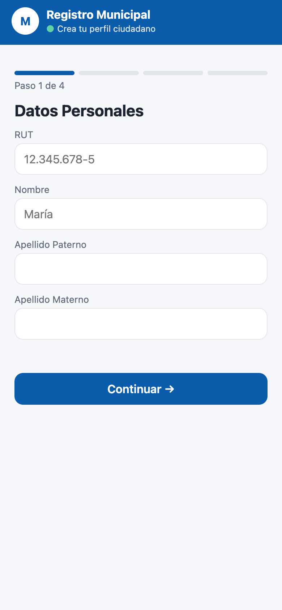
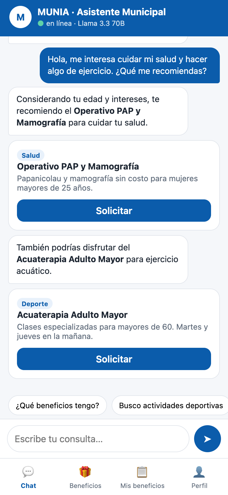
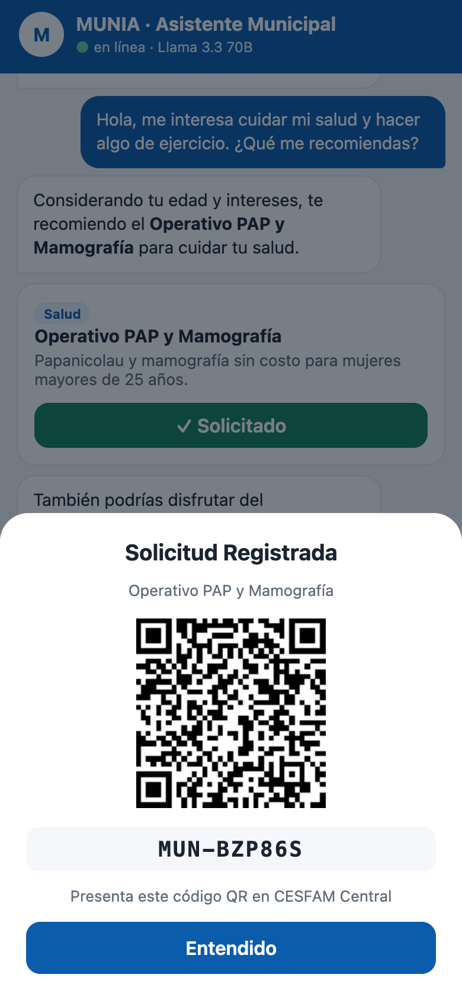
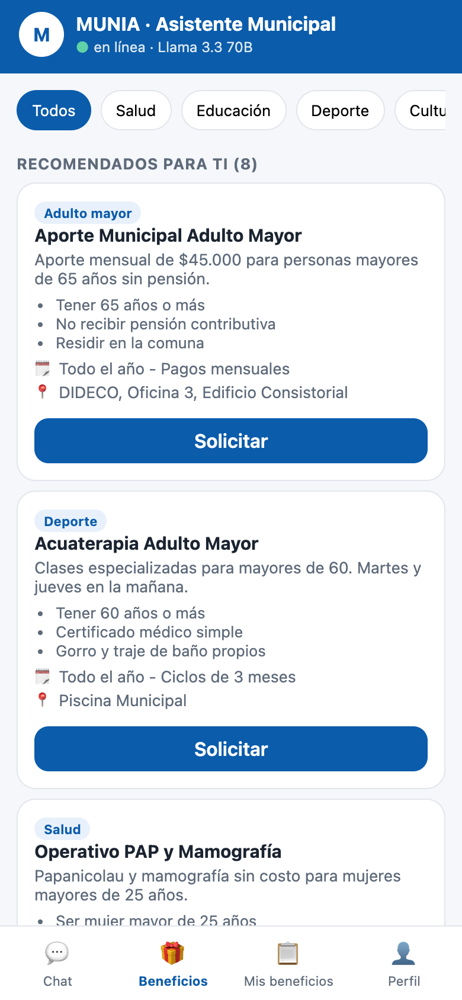

# MUNIA · Hands-on: un asistente municipal con vibe coding

Construye **paso a paso** un prototipo móvil de chatbot municipal que conversa con un **LLM abierto**
(Llama 3.3 70B vía OpenRouter) y recomienda solo los beneficios a los que cada vecino tiene derecho.
Todo se escribe con prompts a **Claude Code**.

<p align="center">
  
  
  
  
</p>

> **Producción vs. hands-on.** En MUNIA el LLM corre **local** en la municipalidad, así que los datos de
> los vecinos no salen de ahí. Hoy usamos OpenRouter con el mismo tipo de modelo (Llama 70B, pesos
> abiertos). Como la API es compatible con OpenAI, pasar a un servidor local (Ollama o vLLM) es
> cambiar `BASE_URL`.

| Paso | Qué construyes | Tiempo |
|---|---|---|
| [0](#paso-0--preparar-el-entorno) | Entorno: Node, Claude Code y tu API key | 10 min |
| [1](#paso-1--servidor-y-proxy-al-llm) | Servidor Node + proxy seguro al LLM | 10 min |
| [2](#paso-2--registro-ciudadano-en-4-pasos) | Registro ciudadano mobile-first | 10 min |
| [3](#paso-3--el-chat-con-llama-33-70b) | Chat con streaming + **reglas de elegibilidad** | 15 min |
| [4](#paso-4--solicitudes-con-qr-y-catálogo) | Solicitudes con QR, catálogo y perfil | 10 min |
| [5](#paso-5--pruébalo-en-tu-teléfono) | Probarlo en tu teléfono | 5 min |

**¿Te atrasaste?** Cada paso tiene su solución en [`soluciones/`](soluciones/). Para seguir desde ahí:

```bash
cp -r soluciones/paso-2/. .     # deja tu proyecto exactamente como al final del paso 2
```

---

## Paso 0 · Preparar el entorno

| Necesitas | Cómo |
|---|---|
| Node 18 o superior | `node -v` (si no lo tienes: [nodejs.org](https://nodejs.org)) |
| Claude Code | `npm install -g @anthropic-ai/claude-code`, luego ejecuta `claude` e inicia sesión |
| API key de OpenRouter | [openrouter.ai/keys](https://openrouter.ai/keys). Carga ~US$1: alcanza para cientos de conversaciones |

```bash
git clone https://github.com/afcarvallo/munia-hands-on.git
cd munia-hands-on
cp .env.example .env        # abre .env y reemplaza PEGA_AQUI_TU_API_KEY por tu key
claude                       # abre Claude Code en esta carpeta (leerá CLAUDE.md)
```

> ⚠️ **La key es como una contraseña.** Va solo en `.env`, que ya está en `.gitignore`. Nunca la
> pegues en el código, en un commit ni en el chat del curso.

Lo que ya trae el repo:

```
CLAUDE.md             reglas del proyecto: Claude Code lo lee al iniciar
.env.example          plantilla de configuración (copia a .env)
data/beneficios.json  14 beneficios municipales ficticios
soluciones/           una solución por paso, por si te atrasas
```

---

## Paso 1 · Servidor y proxy al LLM

Pega este prompt en Claude Code:

> Lee CLAUDE.md. Crea `server.js` en Node sin dependencias que: (1) lea `.env`, (2) sirva los
> archivos de `public/`, (3) exponga `POST /api/chat` que reciba `{perfil, messages}` y llame a
> `${BASE_URL}/chat/completions` con streaming, devolviendo al navegador solo el texto en un stream
> plano. La key nunca debe salir del servidor. Agrega `GET /api/beneficios` que devuelva el JSON.

✅ **Checkpoint:** en una terminal ejecuta `node server.js`. En otra:

```bash
curl -N localhost:3000/api/chat -H 'Content-Type: application/json' \
  -d '{"perfil":{"edad":70},"messages":[{"role":"user","content":"¿qué beneficios de salud tengo?"}]}'
```

La respuesta debe ir apareciendo de a poco. **Guarda lo que responde**: lo vas a comparar en el paso 3.

<details><summary>💡 ¿Por qué un proxy?</summary>

Si el navegador llamara directo a OpenRouter, cualquiera podría abrir las DevTools y copiar tu key.
El servidor la guarda y el navegador solo habla con `/api/chat`.
</details>

---

## Paso 2 · Registro ciudadano en 4 pasos

> Crea `public/index.html`, `styles.css` y `app.js` (JS plano, sin frameworks). Primera pantalla:
> registro en 4 pasos con barra de progreso: (1) RUT con validación de dígito verificador, nombre y
> apellidos; (2) fecha de nacimiento y género; (3) dirección, teléfono, email e ingreso mensual del
> hogar en tramos; (4) intereses como chips (Salud, Educación, Deporte, Cultura, Empleo, Vivienda,
> Adulto mayor). Guarda el perfil en localStorage. Diseño mobile-first que en desktop se vea dentro
> de un marco de iPhone.

✅ **Checkpoint:** abre `http://localhost:3000`, regístrate con el RUT de prueba `11.111.111-1`, recarga
la página y comprueba que el perfil sigue ahí.

Para ver el diseño como en un teléfono: DevTools (`Cmd+Opt+I` / `F12`) → *Toggle device toolbar* → iPhone 14.

---

## Paso 3 · El chat con Llama 3.3 70B

> Después del registro, muestra un chat estilo WhatsApp con streaming desde `/api/chat`, chips de
> sugerencias rápidas y una barra inferior con 4 pestañas: Chat, Beneficios, Mis beneficios y Perfil.
> En el servidor arma un system prompt con: el perfil del vecino, **solo los beneficios para los que
> cumple requisitos según reglas en código** (`edad_min`, `edad_max`, `genero`, `ingreso_max`) y estas
> reglas: no inventar, máximo 120 palabras, y escribir `[[BENEFICIO:id]]` en una línea aparte al
> recomendar uno. El frontend convierte cada etiqueta en una tarjeta con botón "Solicitar", en el
> mismo lugar del texto donde aparece.

✅ **Checkpoint:**
1. Repite el `curl` del paso 1 y compara las respuestas. Antes, el modelo **inventaba** beneficios
   que no existen. Ahora solo nombra beneficios reales del catálogo.
2. Con el perfil de una mujer de 67 años, escribe "quiero cuidar mi salud". No debería aparecer
   *Control Niño Sano*.
3. Pregunta por un "subsidio de arriendo", que no existe: el asistente debe decir que no lo tiene.

<details><summary>💡 La idea clave del taller</summary>

```js
// La elegibilidad la deciden reglas, no el LLM
function elegibles(perfil) {
  return BENEFICIOS.filter((b) =>
    (b.edad_min == null || edad >= b.edad_min) &&
    (b.edad_max == null || edad <= b.edad_max) &&
    (b.genero == null || b.genero === perfil.genero) &&
    (b.ingreso_max == null || ingreso <= b.ingreso_max));
}
```

El modelo **no puede recomendar lo que no ve**. Así hay menos alucinaciones y los criterios se
pueden auditar, algo indispensable en un servicio público.
</details>

---

## Paso 4 · Solicitudes con QR y catálogo

> "Solicitar" genera un código tipo `MUN-AB12CD`, lo guarda en localStorage y muestra una hoja
> inferior con un QR (usa qrcodejs 1.0.0 desde cdnjs) y el lugar donde presentarlo. La pestaña
> Beneficios lista el catálogo con filtros por categoría, separando "Recomendados para ti" de
> "No cumples requisitos". "Mis beneficios" muestra contadores (Solicitados / En proceso / Aprobados)
> y la lista de solicitudes con su QR. En Perfil muestra los datos y agrega "Comenzar de nuevo".

✅ **Checkpoint:** solicita un beneficio desde el chat, cierra el QR, ve a *Mis beneficios* y vuelve a
abrirlo desde ahí.

---

## Paso 5 · Pruébalo en tu teléfono

- **Misma red Wi-Fi:** busca la IP de tu notebook (`ipconfig getifaddr en0` en macOS o `ipconfig` en
  Windows) y abre `http://<IP>:3000` en el teléfono.
- **Sin Wi-Fi compartida:** usa las DevTools en modo dispositivo.

---

## Desafíos extra

1. 🎙️ **Voz:** botón de micrófono con Web Speech API (`webkitSpeechRecognition`, `lang = "es-CL"`).
2. ♿ **Accesibilidad:** modo letra grande y alto contraste para adultos mayores.
3. 📄 **RAG:** carga un PDF de una ordenanza, divídelo en fragmentos y cita la fuente en cada respuesta.
4. 💻 **LLM local:** `ollama run llama3.2` y luego en `.env`: `BASE_URL=http://localhost:11434/v1` y `MODEL=llama3.2`.
5. 🧪 **Evaluación:** escribe 10 preguntas trampa y mide cuántas veces el modelo inventa un beneficio.
6. 🗺️ **Mapa:** muestra dónde se retira cada beneficio con Leaflet.

## Si algo falla

| Síntoma | Causa probable |
|---|---|
| `401` en el chat | Key mal copiada en `.env` o sin crédito en OpenRouter |
| `fetch failed` | Sin internet o la red bloquea openrouter.ai |
| `EADDRINUSE` | Ya hay un servidor en el puerto 3000: ciérralo o cambia `PORT` en `.env` |
| El modelo inventa beneficios | El system prompt no incluye la lista filtrada, o la `temperature` es muy alta (usa 0.3) |
| No aparecen las tarjetas | El modelo escribió `[[id]]` sin `BENEFICIO:`: pide a Claude Code un parser tolerante |

**Pedirle a Claude Code que arregle algo:** pega el error **completo** y explica qué esperabas que pasara.

---

Los datos de `data/beneficios.json` y la "Municipalidad de Villa Esperanza" son **ficticios** y solo
sirven para el taller. Licencia MIT.
